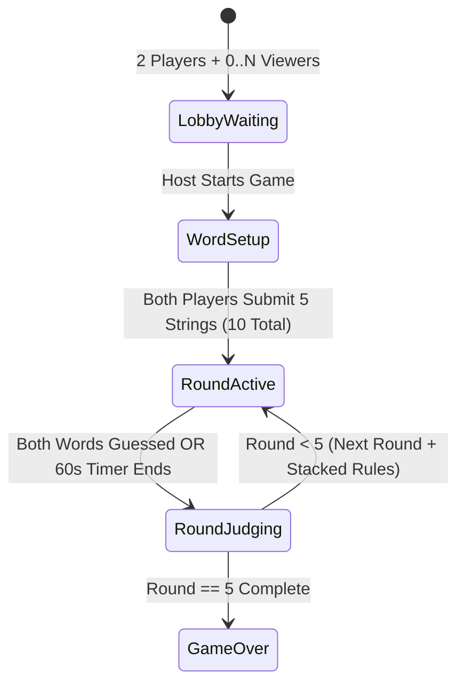

# Game Flow & State Machine — Connect dem Words

Governs the 2-Player + Viewer word-guessing game across Setup, 5 Stacked-Rule Rounds, Viewer Rule Submission, and Judging.

---

## 1. State Machine

---

## 2. Setup & Pair-Deduplication Rules

1. **Roles in Lobby**:
   - Up to **2 Players** occupy `Player 1` and `Player 2` slots.
   - Any additional participants join as **Viewers** (`0..N`).
2. **Word Entry**:
   - Each player enters **5 non-empty strings** (`10` strings total).
   - Players **may** independently enter the same string in their initial lists (e.g., both type `"banana"`).
3. **Round Pair Generation (5 Rounds × 2 Strings)**:
   - The server shuffles all 10 strings into 5 pairs `[wordA, wordB]` with **no string reused across rounds** and **no pair containing identical strings** (`wordA.toLowerCase() !== wordB.toLowerCase()`).
   - **Algorithm**: If a random shuffle produces a duplicate pair (e.g., `["banana", "banana"]`), swap one element with another round's pair until all 5 pairs have `wordA !== wordB`. (If impossible—e.g., >5 identical strings across the 10 inputs—reject at setup or enforce max 5 occurrences total).

---

## 3. Round Loop & Rule Stacking (Rounds 1–5)

### 3.1 Rule Stacking
- **Round 1**: `1` System Rule.
- **Round 2**: Round 1 Rules + `1` new System Rule + `1` random Viewer Rule (if submitted).
- **Round 3–5**: All prior rules remain active + `1` new System Rule + `1` random Viewer Rule (if submitted).

### 3.2 Built-In System Rules Pool (8 Rules)
1. **Must Rhyme**: All spoken clues must rhyme.
2. **No "W" Words**: Cannot say any word starting with the letter **W**.
3. **No Yes/No Questions**: Cannot ask questions answerable with "yes" or "no".
4. **No Filler Words**: Cannot say filler words (*"umm"*, *"uh"*, *"hmm"*, *"like"*).
5. **No Short Words (≤ 3 Letters)**: Cannot use words of 3 or fewer letters (e.g., *"and"*, *"a"*, *"at"*, *"in"*, *"on"*).
6. **No Proper Nouns or Brands**: Cannot name specific people, places, or brands.
7. **5-Word Sentence Limit**: Every spoken clue/sentence must be 5 words or fewer.
8. **Past Tense Only**: All clues must be spoken in the past tense.

### 3.3 Viewer Rule Submission & Lockout
- Each Viewer may submit **at most 1 rule** for the entire game.
- Viewers submit rules **1 round before** the target round starts (e.g., during Round 1 to be eligible for Round 2).
- **10-Second Lockout**: Viewer rule submissions for the upcoming round **lock when `<= 10s` remain** in the current active round.
- At round transition, the server randomly picks **1** submitted viewer rule from the eligible pool for that round (unused viewer rules are not applied).

### 3.4 Round Timer & Judging
- Each round runs a **`60s` (`1 minute`)** countdown timer.
- **Objective**: Both players talk/clue each other to guess both target words without breaking any stacked rule.
- **With Viewers (`viewers > 0`)**:
  - Viewers act as **Judges**: they can flag a rule violation (immediate round loss or strike per judge consensus/majority) and confirm when both words are guessed (`Round Won` vs `Round Lost`).
- **No-Viewer Mode (`viewers === 0`)**:
  - **Trust System**: Players self-police rule violations and click **Both Words Guessed (Win)** or **Rule Broken / Time Up (Loss)** to record the round outcome and advance.

