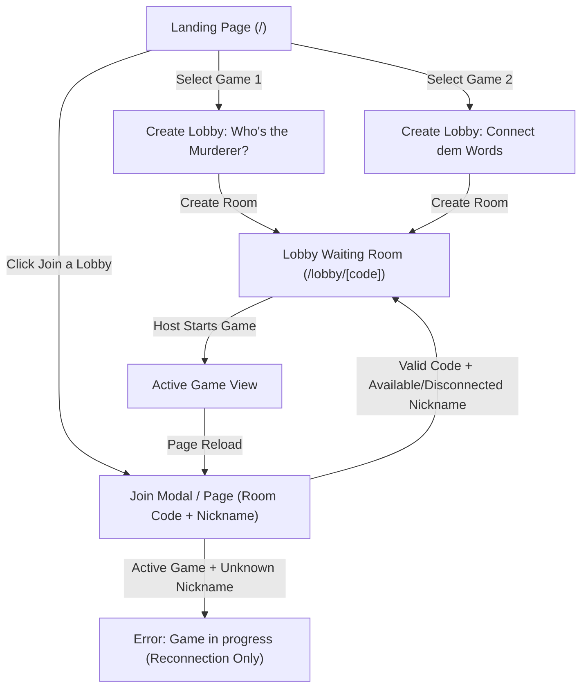

# User Flow & State Machine — Platform & Lobby

Governs the Landing Page, Lobby Creation, `Room Code + Nickname` Join/Rejoin, Host Control Transfer, and 30-Minute Inactivity Cleanup.

---

## 1. High-Level Navigation Flow

---

## 2. Join & Rejoin Decision Rules

1. **Lobby Lookup**:
   - User submits `roomCode` (case-insensitive, normalized uppercase) + `nickname` (trimmed, 1–20 chars).
   - If `roomCode` does not exist or is expired (`> 30 min` inactive) → `404 Lobby not found or expired`.
2. **Lobby State = `waiting`**:
   - If `nickname` is not taken → Create new player row, issue ephemeral session cookie/token for this tab, join lobby.
   - If `nickname` is taken and **offline** (not present in Realtime Presence) → Reclaim slot.
   - If `nickname` is taken and **online** → `409 Nickname already in use`.
3. **Lobby State = `in_progress` (Reconnection Only)**:
   - If `nickname` matches an existing player who is **offline** → Reclaim slot and restore full role/round state.
   - If `nickname` matches an existing player who is **online** → `409 Player is already connected in another tab`.
   - If `nickname` does not exist in the lobby → `403 Game already in progress — reconnection only`.

---

## 3. Host Control Transfer & Cleanup

- **Presence Heartbeat**: Every connected client joins Supabase Realtime Presence channel `lobby:{code}`.
- **Host Disconnect**:
  - When the current `host_player_id` leaves Presence, the server (or next client triggering a presence-sync/action) promotes the **oldest remaining connected player** (`joined_at ASC`) to `is_host = true`.
- **Empty Lobby Wipe**:
  - When connected player count drops to `0` (and grace period of e.g. `15s` for accidental refresh passes, or on explicit "Leave Lobby" by the last player), the lobby is marked expired/deleted.
- **30-Minute Inactivity Wipe**:
  - Every mutating action updates `lobbies.last_activity_at = NOW()`.
  - A scheduled Supabase `pg_cron` job (plus lazy check on any lookup) deletes lobbies where `last_activity_at < NOW() - INTERVAL '30 minutes'`.

