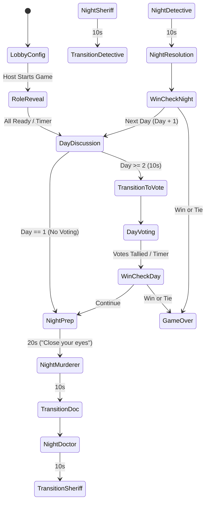

# Game Flow & State Machine — Who's the Murderer?

Covers both **Automatic Mode** (multi-device) and **Manual Mode** (single-device pass-and-play + Admin moderator).

---

## 1. Automatic Mode State Machine

---

## 2. Phase-by-Phase Rules

### 2.1 Role Reveal
- Each player sees only their own role card (`Villager`, `Murderer`, `Doctor`, `Sheriff`, `Detective`).
- **Exception**: `Murderer` players see a list of all fellow `Murderer` players.

### 2.2 Day Phase
- **Day 1**:
  - `60s` (default) open discussion.
  - **No Voting** on Day 1 → transitions directly to `NightPrep`.
- **Day 2+**:
  - `60s` (default) open discussion → `10s` transition → **Day Voting**.
  - Alive players cast 1 vote (or abstain).
  - **Tie**: No player is eliminated.
  - **Majority/Plurality**: Highest-voted player is eliminated and transitions to `dead` (spectator who can view all roles).

### 2.3 Night Phase (Strict Order + 10s Transitions)
- **Night Prep (`20s` default)**: Everyone receives *"Close your eyes and prepare for night"*.
- **Step 1 — Murderer(s) (`60s` default)**:
  - Prompt: *"You have 1 minute to decide who to kill. You may keep your eyes open or close them, then open when ready."*
  - If `Murderers > 1`:
    - `1_kill_per_murderer`: Each alive Murderer picks 1 target.
    - `consensus`: Murderers see each other's live selection and must converge on 1 target (if not agreed by `0s`, no kill or fallback per tie rule).
- **Step 2 — Doctor (`60s` default)** *(skipped automatically if no alive Doctor)*:
  - Picks 1 alive player to heal (self-heal allowed).
  - **Constraint**: `target_id !== doctor_last_healed_target_id`.
- **Step 3 — Sheriff (`60s` default)** *(skipped automatically if no alive Sheriff)*:
  - **Shoot / Eliminate only**: Picks 1 alive player to shoot, or chooses `Skip`.
- **Step 4 — Detective (`60s` default)** *(skipped automatically if no alive Detective)*:
  - **Investigate**: Picks 1 alive player and immediately receives `Good` (`Villager | Doctor | Sheriff | Detective`) or `Bad` (`Murderer`).

### 2.4 Dawn / Night Resolution
- Combine Murderer target(s) + Sheriff target.
- Subtract Doctor's healed target (if Doctor healed a targeted player, that player survives).
- Mark remaining targets as `dead` (dead players immediately unlock **All-Roles Spectator View**).
- Run **Win/Tie Evaluation**.

---

## 3. Win & Tie Evaluation Function

Evaluated in strict priority order:

1. `aliveMurderers === 0` → **Civilians Win**.
2. `aliveTotal === 2 && aliveMurderers === 1 && aliveSheriffs === 1` → **Tie**.
3. `aliveSheriffs >= 1`:
   - If `aliveTotal === 3 && aliveMurderers === 1 && aliveSheriffs === 1` → **Continue**.
   - If `aliveTotal === 4 && aliveMurderers === 2 && aliveSheriffs === 1` → **Continue**.
4. `aliveMurderers >= aliveCivilians` → **Murderers Win**.
5. Otherwise → **Continue**.

---

## 4. Manual Mode (Single-Device Admin Flow)

1. **Setup**: Admin enters player names (or counts `Player 1..N`) and selects role counts (`Murderers`, `Doctors`, `Sheriffs`, `Detectives`; remainder `Villagers`).
2. **Pass-and-Play Role Reveal**:
   - Screen 1: *"Pass device to [Player Name]. Tap to reveal role."*
   - Screen 2: Shows role (+ fellow Murderers if Murderer). Button: *"Hide & Pass to Next Player"*.
   - Repeats until all players have viewed their roles.
3. **Admin Moderation Loop**:
   - Admin clicks **Start Game** (Admin is **not** a player).
   - App displays the current phase (`Day 1 Discussion`, `Night Prep`, `Murderer`, `Doctor`, `Sheriff`, `Detective`, `Day Voting`) with a **non-blocking countdown timer**.
   - Admin can click **Next Phase** at any time (before `0s` or after `0s` has elapsed).
   - **Admin Control Panel**: Displays all players (with secret roles behind an optional Admin-only toggle), allowing Admin to mark any player as **Killed / Voted Out** (or Revive if misclicked). Each status change triggers the **Win/Tie Evaluation Function**.

